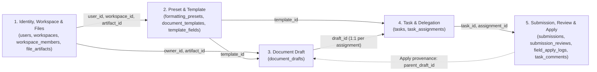
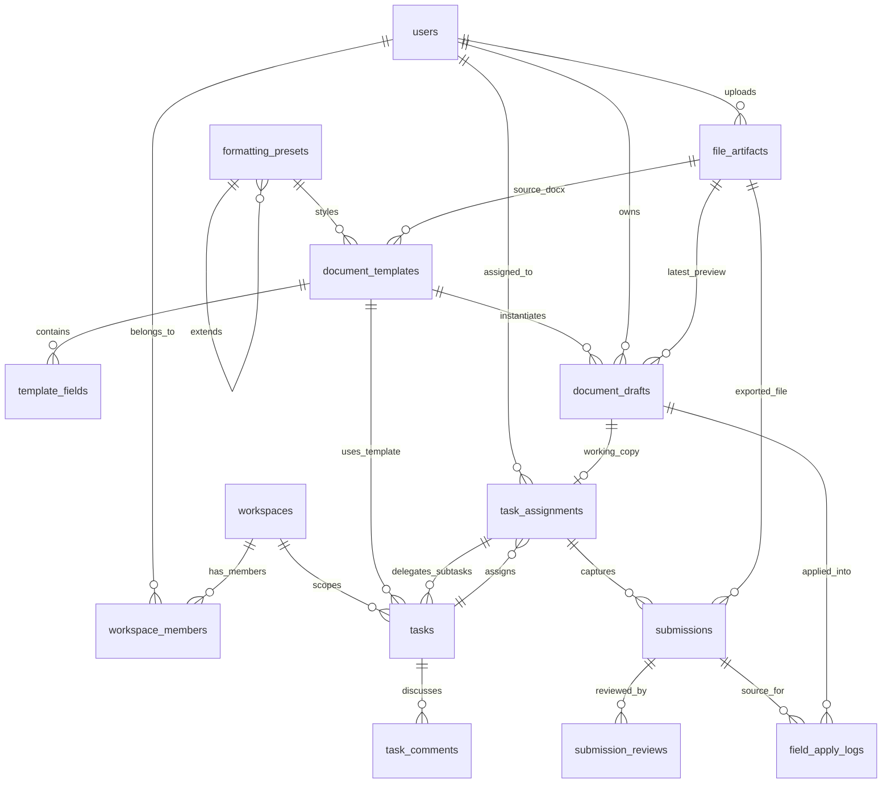
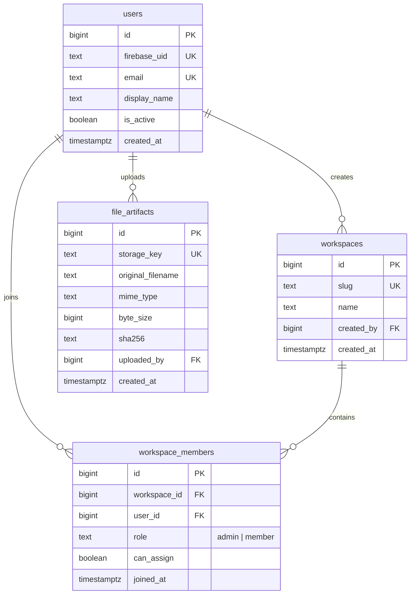
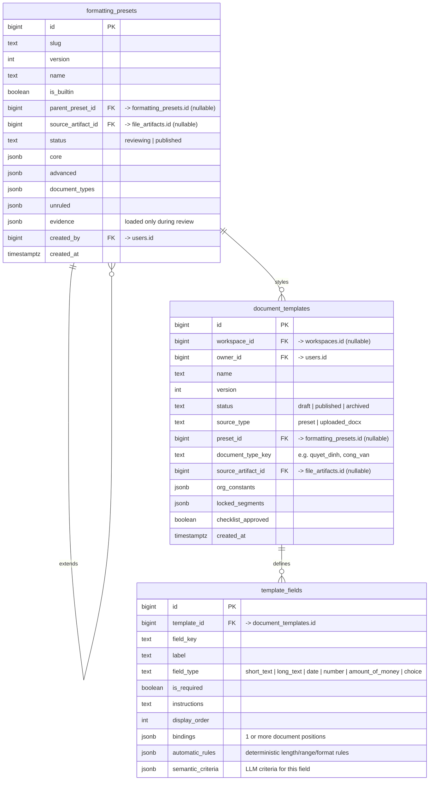
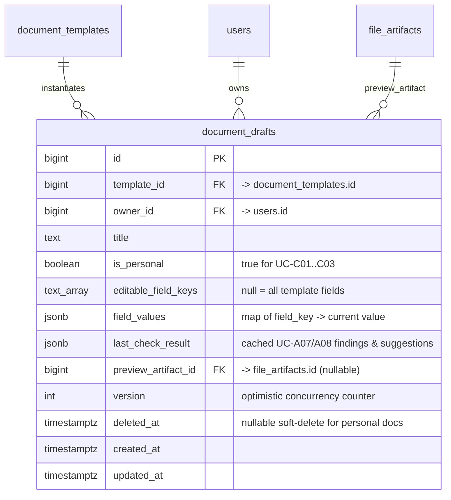
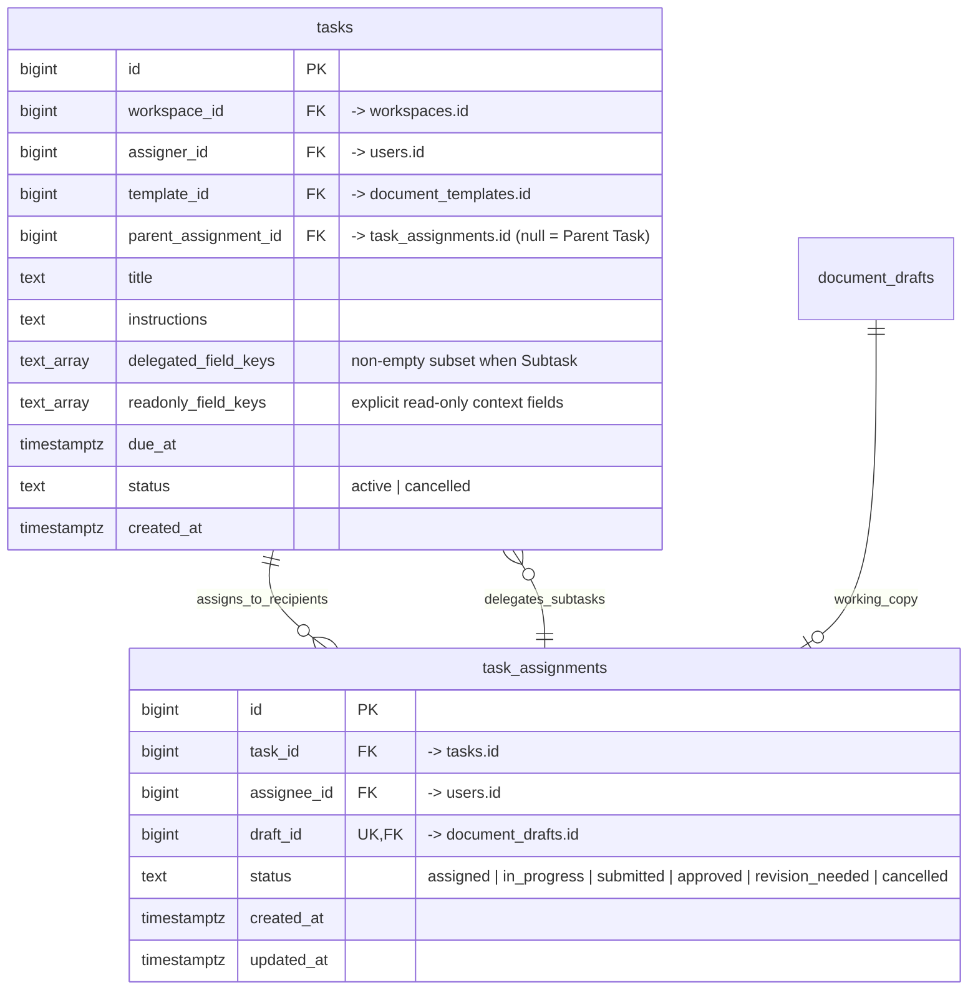
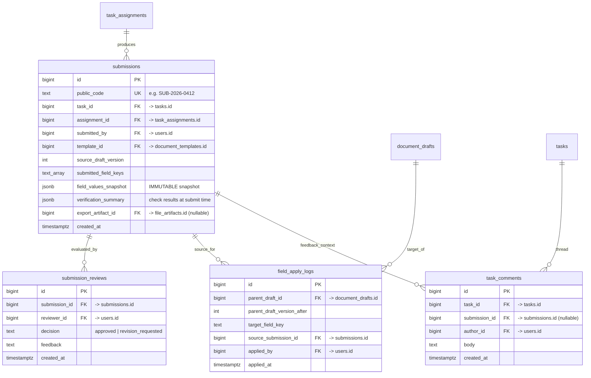

# Database Design & ER Model Overview (DB Component — SAD)

**Status:** Authoritative Logical ER Model & PostgreSQL Schema Baseline (PA03 SAD & MVP Implementation)  
**Grounded in:** [`docs/requirements/vision.md`](../requirements/vision.md), [`docs/requirements/use-case-specification.md`](../requirements/use-case-specification.md), [`PRESET_DOMAIN.md`](PRESET_DOMAIN.md), [`COMMUNICATION_DOMAIN.md`](COMMUNICATION_DOMAIN.md), and [`docs/architecture/c4/README.md`](../architecture/c4/README.md).

---

## 1. Purpose & Alignment with C4 Architecture

In the C4 Container and Backend Component diagrams (`AD-02`, `AD-03`, `AD-04`, `AD-07`), persistent state is split across two storage containers:

1. **PostgreSQL Relational Database (`Persistence & File Gateways` component)**: Stores all structured metadata, workspace memberships, versioned presets and templates, typed form fields, mutable drafts, task/subtask assignments, immutable submission snapshots, reviews, provenance logs, and task discussions.
2. **Document File Store (Cloudflare R2 / Local File Storage)**: Stores binary `.docx` and `.pdf` files (uploaded source templates,regulation files, rendered previews, and exported snapshots). PostgreSQL never stores large binary blobs; it references files through the `file_artifacts` entity.

### PostgreSQL Physical Design Standards (`supabase-postgres-best-practices`)

- **Identifiers**: Unquoted lowercase `snake_case` for all table, column, index, and constraint names.
- **Primary Keys**: `bigint generated always as identity primary key` across all entities for sequential B-tree locality and low index overhead; human-readable identifiers (`slug`, `public_code`) carry `UNIQUE` constraints where exposed in the UI.
- **Data Types**:
  - Timestamps: `timestamptz` (timezone-aware UTC).
  - Strings: `text` (with `CHECK` constraints where bounded), avoiding arbitrary `varchar(n)`.
  - Structured Trees / Flexible Payloads: `jsonb` for Preset blocks (`core`, `advanced`, `document_types`, `unruled`, `evidence`), field bindings/checklists, and draft/submission field values.
  - Status & Type Enums: `text` with `CHECK (... IN (...))` constraints for safe schema evolution.
- **Organizational Continuity (`Vision §5`)**: User records are soft-deactivated (`is_active = false`) rather than hard-deleted (`ON DELETE RESTRICT` on user foreign keys) so historical tasks, drafts, and submissions remain intact when personnel change.

---

## 2. Sub-Domain Organization & Bridge Relationships

To keep modules cohesive and loosely coupled, the schema is organized into **5 sub-domains**:



- **Sub-domains 1 + 2 + 3** operate independently to support **Group A** (Preset/Template authoring & Form filling) and **Group C** (Personal Documents `UC-C01–UC-C03`).
- **Sub-domains 4 + 5** extend the workflow for **Group B** (Workspace task assignment, field-scoped subtask delegation, immutable submissions, reviews, and manual synthesis `UC-B01–UC-B08`).

---

## 3. Complete ER Diagram (SAD Overview)



---

## 4. Sub-Domain ER Models & Entity Specifications

### 4.1. Sub-Domain 1: Identity, Workspaces & File Artifacts

Supports authentication (`Firebase Auth`), two-tier workspace isolation (`Vision B6`, `B10`, `COMMUNICATION_DOMAIN.md §3`), and object-storage file metadata (`AD-03`).



| Entity | Key Attributes & Constraints | Relationships & Domain Rules |
| :--- | :--- | :--- |
| **`users`** | `id` (PK), `firebase_uid` (UK, NOT NULL), `email` (UK, NOT NULL), `display_name`, `is_active` (default `true`), `created_at` | Represents authenticated users. Note: `Assigner` and `Assignee` are contextual per task, never stored as a fixed role on `users`. |
| **`workspaces`** | `id` (PK), `slug` (UK), `name` (NOT NULL), `created_by` (FK → `users.id`), `created_at` | Collaboration boundary isolating tasks, members, and discussions (`I4`). |
| **`workspace_members`** | `id` (PK), `workspace_id` (FK → `workspaces.id` ON DELETE CASCADE), `user_id` (FK → `users.id` ON DELETE RESTRICT), `role` (`admin` \| `member`), `can_assign` (`boolean`), `UNIQUE (workspace_id, user_id)` | Controls who can view workspace tasks and who may create tasks/subtasks inside that workspace (`UC-B01`, `UC-B03`). |
| **`file_artifacts`** | `id` (PK), `storage_key` (UK, NOT NULL), `original_filename`, `mime_type`, `byte_size`, `sha256`, `uploaded_by` (FK → `users.id`), `created_at` | Metadata pointer for every binary file in R2/Local storage (uploaded DOCX templates, regulation PDFs, rendered previews, exported snapshots). |

---

### 4.2. Sub-Domain 2: Formatting Presets, Document Templates & Fields

Realizes `Vision A1–A7`, `UC-A01–UC-A05`, and [`PRESET_DOMAIN.md`](PRESET_DOMAIN.md).



| Entity | Key Attributes & Constraints | Relationships & Domain Rules |
| :--- | :--- | :--- |
| **`formatting_presets`** | `id` (PK), `slug` (NOT NULL), `version` (NOT NULL), `UNIQUE (slug, version)`, `parent_preset_id` (self-FK), `status` (`reviewing` \| `published`), `core`, `advanced`, `document_types`, `unruled`, `evidence` (all `jsonb`) | Saving a preset creates a new immutable `version` (`UC-A01`). Separating `evidence` into its own `jsonb` column allows the Renderer to `SELECT core, advanced, document_types` without loading regulatory quotes. |
| **`document_templates`** | `id` (PK), `owner_id` (FK → `users.id`), `workspace_id` (nullable FK → `workspaces.id`), `version` (NOT NULL), `status` (`draft` \| `published` \| `archived`), `source_type` (`preset` \| `uploaded_docx`), `preset_id` (nullable FK), `source_artifact_id` (nullable FK), `org_constants` (`jsonb`), `locked_segments` (`jsonb`), `checklist_approved` (`boolean`) | Supports both preset-generated skeletons (`source_type = 'preset'`) and uploaded DOCX files (`source_type = 'uploaded_docx'`, `UC-A02`). Tasks and drafts bind to a specific `document_templates.id` version row. |
| **`template_fields`** | `id` (PK), `template_id` (FK → `document_templates.id` ON DELETE CASCADE), `field_key` (NOT NULL), `UNIQUE (template_id, field_key)`, `label`, `field_type`, `is_required`, `instructions`, `display_order`, `bindings` (`jsonb`), `automatic_rules` (`jsonb`), `semantic_criteria` (`jsonb`) | Stores typed fields configured in `UC-A03` and checklist rules approved in `UC-A04`. `bindings` is a JSON array because one field can map to multiple positions in the document. |

---

### 4.3. Sub-Domain 3: Document Drafts (Shared by Tasks & Personal Documents)

Realizes `Vision A8–A13`, `UC-A06–UC-A09` (Guided Form Filling, Live Preview, Content Check, Correction Suggestions, Export) and `UC-C01–UC-C03` (Personal Documents).



| Entity | Key Attributes & Constraints | Relationships & Domain Rules |
| :--- | :--- | :--- |
| **`document_drafts`** | `id` (PK), `template_id` (FK → `document_templates.id`), `owner_id` (FK → `users.id`), `title`, `is_personal` (`boolean`), `editable_field_keys` (`text[]` nullable), `field_values` (`jsonb`), `last_check_result` (`jsonb`), `preview_artifact_id` (nullable FK → `file_artifacts.id`), `version` (`int` default `1`), `deleted_at` (`timestamptz` nullable) | Single unified working-copy entity for both **Personal Documents** (`is_personal = true`) and **Task Assignments** (`is_personal = false`). `version` increments on every autosave or `Apply` to prevent lost updates. |

---

### 4.4. Sub-Domain 4: Tasks, Recipient Assignments & Subtask Delegation

Realizes `Vision B1, B4, B7, B8, B10`, `UC-B01–UC-B03`, `UC-B08`, and [`COMMUNICATION_DOMAIN.md §§4–5`](COMMUNICATION_DOMAIN.md).



| Entity | Key Attributes & Constraints | Relationships & Domain Rules |
| :--- | :--- | :--- |
| **`tasks`** | `id` (PK), `workspace_id` (FK → `workspaces.id`), `assigner_id` (FK → `users.id`), `template_id` (FK → `document_templates.id`), `parent_assignment_id` (nullable FK → `task_assignments.id`), `delegated_field_keys` (`text[]`), `readonly_field_keys` (`text[]`), `due_at` (`timestamptz`), `status` (`active` \| `cancelled`) | Models both **Parent Tasks** (`parent_assignment_id IS NULL`) and **Subtasks** (`parent_assignment_id IS NOT NULL`, with `CHECK (cardinality(delegated_field_keys) > 0)`). **No uniqueness constraint** is placed on `delegated_field_keys` across sibling Subtasks because field overlap is explicitly permitted (`DEC-005`). |
| **`task_assignments`** | `id` (PK), `task_id` (FK → `tasks.id`), `assignee_id` (FK → `users.id`), `draft_id` (UK, FK → `document_drafts.id`), `status`, `UNIQUE (task_id, assignee_id)` | Guarantees **per-recipient independence**: each assignee on a multi-recipient Task or Subtask receives their own `task_assignments` row and their own isolated `document_drafts` row. |

---

### 4.5. Sub-Domain 5: Immutable Submissions, Reviews, Apply Provenance & Discussions

Realizes `Vision B2, B5, B6, B9`, `UC-B04–UC-B07`, and invariants `I1–I5` in [`COMMUNICATION_DOMAIN.md §§5–9`](COMMUNICATION_DOMAIN.md).



| Entity | Key Attributes & Constraints | Relationships & Domain Rules |
| :--- | :--- | :--- |
| **`submissions`** | `id` (PK), `public_code` (UK, NOT NULL), `task_id` (FK), `assignment_id` (FK), `submitted_by` (FK), `template_id` (FK), `source_draft_version`, `submitted_field_keys` (`text[]`), `field_values_snapshot` (`jsonb`), `verification_summary` (`jsonb`), `export_artifact_id` (nullable FK), `created_at` | **Strictly Immutable (`I1`)**: Captures a point-in-time snapshot when an Assignee clicks Submit (`UC-B04`). No `updated_at` column exists; rows are never mutated after insert, and the underlying `document_drafts` row remains unlocked. |
| **`submission_reviews`** | `id` (PK), `submission_id` (FK → `submissions.id`), `reviewer_id` (FK → `users.id`), `decision` (`approved` \| `revision_requested`), `feedback`, `created_at` | Always binds to a specific `submission_id` (`UC-B05`), never to the live `DocumentDraft`. Approving a child submission updates the child `task_assignments.status` but never auto-submits or approves the Parent Task (`I2`). |
| **`field_apply_logs`** | `id` (PK), `parent_draft_id` (FK → `document_drafts.id`), `parent_draft_version_after` (`int`), `target_field_key` (`text`), `source_submission_id` (FK → `submissions.id`), `applied_by` (FK → `users.id`), `applied_at` | Records structured provenance whenever a Parent Assignee applies a delegated field value from a Child `Submission` into the Parent `DocumentDraft` (`UC-B06`, `I3`). |
| **`task_comments`** | `id` (PK), `task_id` (FK → `tasks.id`), `submission_id` (nullable FK → `submissions.id`), `author_id` (FK → `users.id`), `body` (NOT NULL), `created_at` | Task-scoped discussion messages (`UC-B07`), isolated within the task's workspace and authorized participants. |

---

## 5. Indexing & Transaction Rules for Implementation

### 5.1. Mandatory Indexes
1. **Foreign Key Indexes**: Every FK column across all 14 tables must have a B-tree index.
2. **Composite Indexes (Equality before Range/Sort)**:
   - `tasks (workspace_id, status, due_at)` — Workspace task dashboard & overdue filter (`UC-B08`).
   - `task_assignments (assignee_id, status, updated_at desc)` — Assignee task list (`UC-B02`).
   - `submissions (assignment_id, created_at desc)` — Per-recipient submission history (`UC-B05`).
   - `task_comments (task_id, created_at asc)` — Task discussion feed (`UC-B07`).
3. **Partial Indexes**:
   - `document_drafts (owner_id, updated_at desc) WHERE is_personal = true AND deleted_at IS NULL` — Personal document library (`UC-C03`).
   - `tasks (parent_assignment_id) WHERE parent_assignment_id IS NOT NULL` — Fast lookup of delegated Subtasks for a Parent Assignment (`UC-B03`, `UC-B06`).

### 5.2. Transaction & Concurrency Rules
1. **Short Transactions Only (`lock-short-transactions`)**: Never hold an open database transaction or row lock while invoking **LibreOffice Headless** (`UC-A06` preview / `UC-A09` export) or **Ollama LLM** (`UC-A07` semantic check). Read the draft state, close the transaction, run external inference/rendering, then open a millisecond transaction to persist results.
2. **Optimistic Concurrency Control**: Updating `document_drafts` (via autosave `UC-A06` or manual `Apply` `UC-B06`) must check and increment `version`:
   ```sql
   update document_drafts
   set field_values = $1, version = version + 1, updated_at = now()
   where id = $2 and version = $3
   returning version;
   ```
   If `0` rows are returned, reject with a `409 Conflict` so the client refreshes before overwriting (`UC-B06 A2`).
