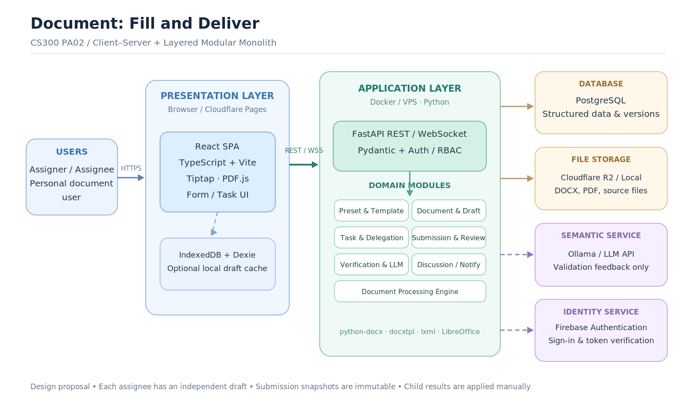
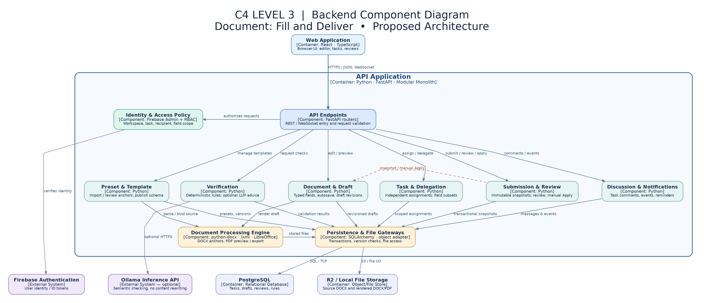

# CS300 PA02 — Basic Software Architecture

**Product:** Document: Fill and Deliver  
**Status:** Design proposal / architecture baseline (not a claim about production deployment)  
**Architecture style:** Client–Server + Three-Tier Layered Architecture + Modular Monolith  
**Primary interfaces:** HTTPS REST API, WebSocket (for task/discussion updates)

## 1. Overview

### Three-tier architecture

| Tier | Components | Execution location | Language and frameworks |
|---|---|---|---|
| Presentation | Template Editor, Form Filler, Split-screen Live Preview, Task Dashboard, Discussion/Notification UI | End-user browser; static frontend deployed on Cloudflare Pages (proposed) | TypeScript, React, Vite, React Hook Form, Zod, Tiptap, PDF.js; optional Dexie/IndexedDB |
| Application | FastAPI routers, authentication/authorization checks, template/preset logic, document/draft service, tasks/delegation, immutable submissions, review/manual Apply, verification, document processing | A single modular backend process/container on Docker/VPS | Python, FastAPI, Pydantic, SQLAlchemy, python-docx, docxtpl, lxml, LibreOffice Headless |
| Data | Structured metadata and transactional records; original DOCX/templates, generated DOCX/PDF, snapshots | PostgreSQL and R2 or local filesystem for MVP | PostgreSQL, S3-compatible storage adapter |
| External services | Sign-in and ID-token verification; semantic content-check inference | Provider-managed services outside the application | Firebase Authentication, Ollama-compatible LLM API (implementation to be finalized) |

### Component diagram

The backend is **one deployable application with separate domain modules**. Domain modules do not imply individually deployed microservices. The document renderer may run through a controlled subprocess or worker if needed.

## 2. Components and responsibilities

| Component | Responsibility | Dependencies |
|---|---|---|
| Authentication & Authorization | Verify identity; enforce workspace, task, document and field-level access rights | Firebase Auth, PostgreSQL |
| Preset & Template Management | Import DOCX, preserve style/structure, detect and review fields, configure formatting presets and checklists, publish templates | PostgreSQL, object storage, document parser |
| Document & Draft Management | Generate typed forms, handle autosave, persist editable drafts, support personal documents, request preview/export | PostgreSQL, document renderer |
| Task & Delegation | Create tasks and independent per-recipient assignments; delegate nonempty field subsets into internal workspace subtasks | PostgreSQL, authorization |
| Submission & Review | Create immutable submission snapshots, track feedback/approvals and manually apply authorized child fields into a parent draft with version/provenance checks | PostgreSQL transactions, object storage |
| Verification | Execute deterministic field checks; optionally call LLM for evidence-backed advisory findings | Rule engine, external LLM API |
| Document Processing Engine | Parse/modify DOCX at field anchors; generate DOCX and authoritative PDF; provide rendered preview | python-docx, docxtpl, lxml, LibreOffice |
| Discussion & Notification | Record task-scoped communication, progress events and reminders (if enabled) | PostgreSQL, REST/WebSocket, optional scheduler |

## 3. Core interaction flows

### A. Prepare → Fill → Validate → Export

1. Template creator imports a source DOCX or selects a built-in preset.
2. Template service extracts candidate editable fields; creator reviews and publishes the template with a version identifier.
3. Filler opens a typed form. Browser sends draft updates to the API (with optional IndexedDB caching).
4. Document service saves draft revisions and requests authoritative server-side preview from the same document-rendering pipeline used for export.
5. Verification applies deterministic rules and, on request, produces LLM warnings with evidence; LLM does not rewrite the user's document.
6. Export service applies template/preset rules and returns generated DOCX or PDF. Broken mandatory deterministic constraints can block final export, while optional advisory LLM findings do not.

### B. Assign → Delegate → Submit → Review → Apply

1. Assigner creates a task from a published template in an authorized workspace.
2. Each recipient obtains **an independent assignment and draft**.
3. A parent assignee may create subtasks with explicitly selected field subsets in an authorized internal workspace.
4. `Submit` saves a **new immutable snapshot**, leaving the active draft editable.
5. Reviewer evaluates a specific `submission_id` and records Approve or Request Revision.
6. Parent assignee explicitly reviews and applies selected child snapshot fields into their parent draft, with source provenance and overwrite/version checks. No automatic parent submission/approval occurs.

## 4. Design decisions and rationale

| Decision | Rationale | Trade-off |
|---|---|---|
| AD-01: Modular Monolith rather than microservices | Small team, common transaction boundaries, simpler testing/deployment | Separate service scaling is limited initially |
| AD-02: Central PostgreSQL | Consistent task, draft, snapshot and permission data | Database schema coordination is necessary |
| AD-03: Object storage for document binaries | Avoid storing large files in relational records; easier versioning/download controls | Separate backup and authorization policy required |
| AD-04: Immutable submissions with editable drafts | Reliable review history while allowing continued work | Must model draft and submission separately |
| AD-05: Authoritative DOCX/PDF rendering pipeline | Reduces discrepancies between preview and exported document | Server-side rendering may be expensive; cache/debounce results |
| AD-06: Deterministic validation + advisory LLM | Hard validation rules remain reliable and audit-friendly | Semantic warnings are not guaranteed correct |
| AD-07: Field- and workspace-scoped permission checks | Protects parent/child data and recipient independence | Authorization queries and test coverage become more complex |

## 5. Non-functional considerations

- **Security:** Every object request must verify workspace membership, assignment ownership and field scope; document file download requires access checks, not only a guessable URL.
- **Integrity:** Task status changes, snapshot creation and Apply-to-parent should be transactional. Optimistic revision checks prevent silent overwrites.
- **Maintainability:** Routers, application services, repositories and external gateways have separate responsibilities, even though deployed as one backend.
- **Document fidelity:** Use a single verified conversion pipeline; include DOCX/PDF regression fixtures and reject unsupported cases rather than silently mangling them.
- **Availability:** Back up PostgreSQL and stored files; isolate potentially unsafe LibreOffice processing in a limited-permission runtime.
- **Performance:** Debounce autosave and preview renders; allow cached or background rendering where needed, without changing the authoritative output contract.

## 6. Status and scope of this document

This is an **architecture baseline**, combining the system's C4 model with the repository's authoritative requirements and domain specifications. Active decisions and open questions are tracked in [`docs/management/DECISIONS.md`](../../../management/DECISIONS.md) and [`docs/management/ISSUES.md`](../../../management/ISSUES.md).

## 7. Authoritative repository references

- [`docs/requirements/vision.md`](../../../requirements/vision.md) — Vision Document (v2.1)
- [`docs/requirements/use-case-specification.md`](../../../requirements/use-case-specification.md) — Use-Case Specification (v1.1)
- [`docs/analysis-and-design/PRESET_DOMAIN.md`](../../../analysis-and-design/PRESET_DOMAIN.md) — Preset & Template Domain Specification
- [`docs/analysis-and-design/COMMUNICATION_DOMAIN.md`](../../../analysis-and-design/COMMUNICATION_DOMAIN.md) — Communication & Delegation Domain Specification
- [`docs/analysis-and-design/database-overview.md`](../../../analysis-and-design/database-overview.md) — Database Design & ER Model Overview
- [`docs/management/DECISIONS.md`](../../../management/DECISIONS.md) & [`docs/management/ISSUES.md`](../../../management/ISSUES.md) — Live Decision and Issue Logs
