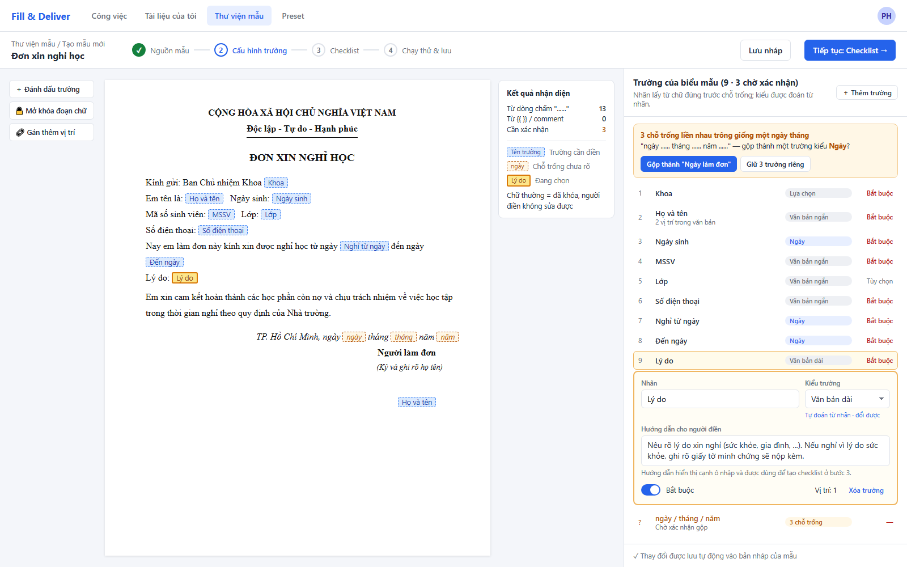
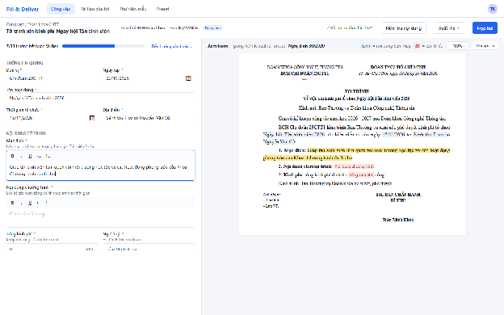
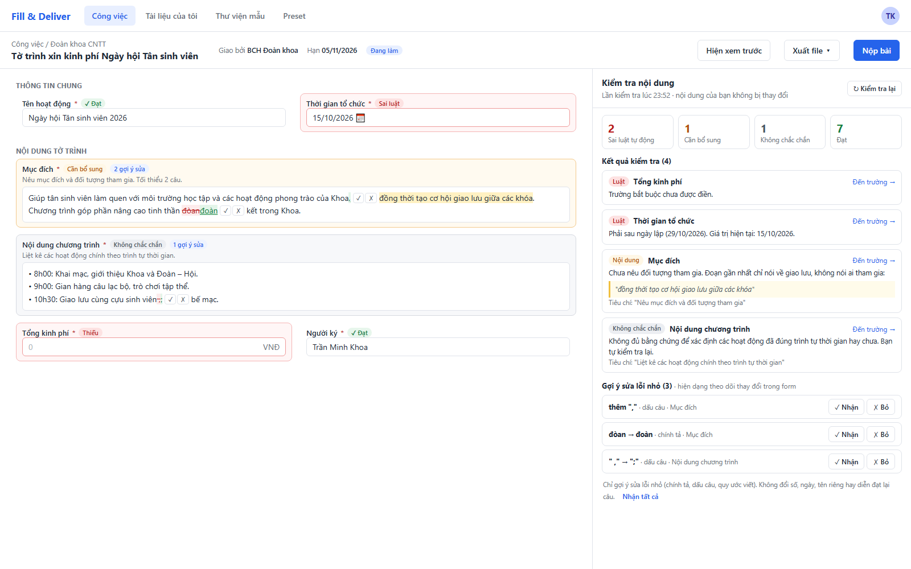
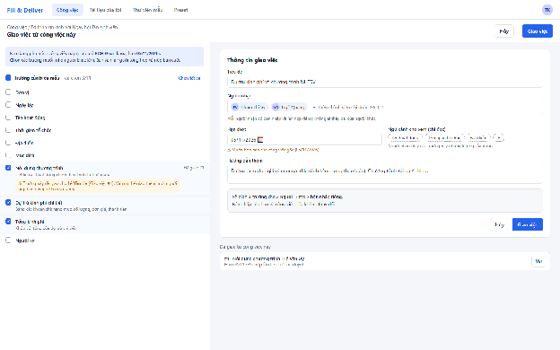
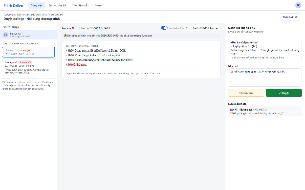
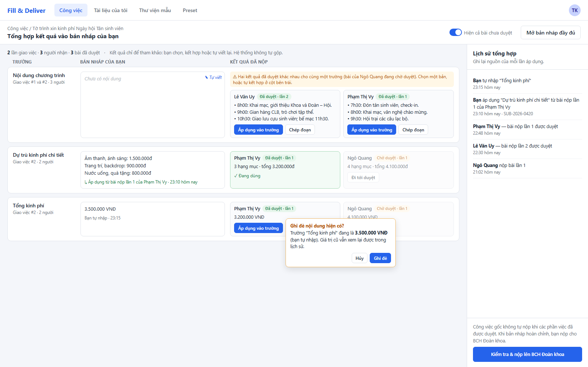

**Document: Fill and Deliver**

# UI Prototype — PA02

## Overview

This document presents six UI prototypes for the key use cases of the two main feature groups: Automatic Document Filling (Group A) and Work Communication (Group B). The screens revise the PA01 prototypes to match the use-case specifications of PA02, and each screen lists the use cases it realizes together with a mapping from the steps of the specification to the elements of the UI.

All screens follow one scenario. The faculty Youth Union assigns a funding request for the Freshman Welcome Day to a class Youth Union secretary. The secretary fills in the form, checks the content, delegates the programme and the budget to class members, reviews their submissions and integrates the results before submitting to the faculty. Screen 1 uses a separate leave-of-absence form to show how a plain DOCX with dotted blanks becomes a form. The interface text is in Vietnamese, the language of the target users.

### Use-case coverage

| Screen | Group | Use cases | Actor |
| :--- | :--- | :--- | :--- |
| 1. Form Field Configuration | A | UC-A03 | Template Creator |
| 2. Guided Form Filling with Live Preview | A | UC-A06 | Filler |
| 3. Content Check and Correction Suggestions | A | UC-A07, UC-A08 | Filler |
| 4. Assign Work from a Form | B | UC-B03 (layout also used by UC-B01) | Assigner |
| 5. Review a Submission | B | UC-B05 (with UC-B04 history, UC-A09 export) | Assigner |
| 6. Integrate Delegated Results | B | UC-B06 | Assignee of the parent task |

### Changes from PA01

| PA01 screen | PA02 screen | Main change |
| :--- | :--- | :--- |
| Template Editor | Screen 1 · Form Field Configuration | Blank-pattern detection; checklist and preset moved to their own steps |
| Document Completion (Split View) | Screen 2 · Guided Form Filling with Live Preview | Inputs by field type, collapsible preview, opened from a task |
| Content Verification and Export | Screen 3 · Content Check and Correction Suggestions | Quoted evidence, uncertain findings, tracked-change suggestions |
| Task Assignment and Progress Tracking | Screen 4 · Assign Work from a Form; Screen 5 · Review a Submission | Field-level delegation; review of immutable snapshots |
| — | Screen 6 · Integrate Delegated Results | New |
| Document Filler Dashboard | Not redrawn | Standard task list (UC-B02); no change in behaviour |

---

## Screen 1: Form Field Configuration

**User role:** Template Creator

**Related use cases:** UC-A03 Configure Form Fields (step 2 of the template wizard: UC-A02 → UC-A03 → UC-A04 → UC-A05)

*Figure 1. Form Field Configuration*

### Description

The Template Creator has uploaded a traditional leave-of-absence form that contains only dotted blanks and no markup. The system turns each blank into a proposed field, shown as a blue chip in the document, while all remaining text is locked. The right panel lists the proposed fields; the creator adjusts labels, types, required flags and instructions, and resolves blanks the system is not sure about.

### Key features

- Automatic field detection from {{markers}}, comments and blank patterns, with a summary of what was detected.
- Field label taken from the text before the blank; field type inferred from the label and editable.
- One field mapped to several positions (for example the applicant's name in the body and under the signature).
- Ambiguous blanks such as "ngày ... tháng ... năm ..." are flagged and can be merged into one date field.
- Manual tools to mark a field, lock or unlock text, and map additional positions.
- Changes are saved automatically to the template draft.

### Pain points addressed

- Standard forms circulate as DOCX files with dotted blanks, so turning them into structured forms is tedious manual work.
- Instructions written as placeholder text disappear once the placeholder is replaced.

### Use-case specification mapping

| Specification step | UI element |
| :--- | :--- |
| Step 1: detect fields from markers, comments and blank patterns | Blue field chips in the document; "Kết quả nhận diện" summary (13 blanks from dotted lines) |
| Step 2: label from preceding text, infer type, lock other text | "Tự đoán từ nhãn · đổi được" under the type; plain document text is locked |
| Step 3: show proposed fields next to the document | Field list in the right panel |
| Step 4: add, remove, rename, map to several positions | "＋ Thêm trường", "Gán thêm vị trí"; "Họ và tên" shows "2 vị trí" |
| Step 5: set type, required flag and instructions | Expanded editor of the field "Lý do" |
| Step 6: save field configuration | Autosave note; "Tiếp tục: Checklist" leads to UC-A04 |
| A1: no fields detected; mark manually | "＋ Đánh dấu trường" tool |
| A3: lock or unlock a text segment | "Mở khóa đoạn chữ" tool |
| A4: ambiguous blank pattern | Orange card with "Gộp thành 'Ngày làm đơn'" / "Giữ 3 trường riêng" |

### Revision from PA01

Revised from the PA01 Template Editor. Fields are now also detected from blank patterns (dotted lines, underscores, empty table cells), with labels and field types inferred from the surrounding text, and ambiguous blanks are confirmed by the creator. Verification rules and the formatting preset were moved out of this screen into their own steps (UC-A04 and UC-A02).

---

## Screen 2: Guided Form Filling with Live Preview

**User role:** Filler (Assignee in a task, or Individual User)

**Related use cases:** UC-A06 Fill Document Form; entry points to UC-A07 Check Content, UC-A09 Export Document and UC-B04 Submit Document

*Figure 2. Guided Form Filling with Live Preview*

### Description

A class Youth Union secretary fills in a funding request assigned by the faculty Youth Union. The form is on the left and a live preview of the final document is on the right. The filler only enters content; the system places it in the right positions and applies the official format. Instructions stay under each label and a progress bar shows how many required fields are done.

### Key features

- Inputs by field type: date picker, amount of money, short text, and long text with minimal rich text (bold, italic, underline, lists).
- Instructions always visible under each field label.
- Collapsible live preview that looks exactly like the exported file; entered values in blue, missing values in red.
- Progress indicator of required fields with a shortcut to the next missing field.
- Automatic draft saving with the time of the last save.
- Actions to check content, export and submit from the same screen.

### Pain points addressed

- Users have to handle both content and formatting, which slows them down and causes formatting errors.
- Long documents are written over several sessions and progress is easy to lose track of.

### Use-case specification mapping

| Specification step | UI element |
| :--- | :--- |
| Step 1: open a Draft from an assigned task | Breadcrumb "Công việc / Đoàn khoa CNTT", assigner and deadline in the header |
| Step 2: form and collapsible preview; inputs by type; instructions | Left form, right preview with "Thu gọn"; help text under labels |
| Step 3: enter content, minimal rich text in long fields | Toolbar B / I / U / lists in "Mục đích" |
| Step 4: autosave, refresh preview, update progress | "Đã lưu tự động lúc 23:41"; highlighted text in the preview; "7/11 trường bắt buộc" |
| Step 5: leave and return later | Draft is saved on the server; the task reopens at the same state |
| A2: value does not match the field type | Date and money inputs only accept valid values |

### Revision from PA01

Revised from the PA01 Document Completion screen. The form is opened from an assigned task, each field uses an input suited to its type, and the preview can be collapsed. The preview follows the template's formatting preset (Decree 30/2020) and marks entered and missing content.

---

## Screen 3: Content Check and Correction Suggestions

**User role:** Filler

**Related use cases:** UC-A07 Check Content; UC-A08 Review Correction Suggestions

*Figure 3. Content Check and Correction Suggestions*

### Description

After requesting a content check, the filler sees a summary and the findings per field. Automatic rules are checked exactly, while the remaining criteria are checked by a large language model that must quote the part of the content supporting each finding. Small fixes for spelling and punctuation appear as tracked changes inside the form, and the filler accepts or rejects each one.

### Key features

- Summary of broken rules, content issues, uncertain findings and passed criteria.
- Fields with issues are highlighted in the form, with links from each finding to its field.
- Every content finding shows the quoted evidence and the criterion it was checked against.
- Uncertain findings are labelled instead of being reported as errors.
- Correction suggestions only for minor errors (spelling, typos, punctuation, conventions), shown as tracked changes.
- The check never changes the content; suggestions are applied only when the filler accepts them.

### Pain points addressed

- Errors are discovered only after submission, leading to several rounds of revision.
- There is no way to check whether the content follows the instructions before sending it.

### Use-case specification mapping

| Specification step | UI element |
| :--- | :--- |
| UC-A07 step 1: request a content check | "Kiểm tra nội dung" (Screen 2) and "↻ Kiểm tra lại" |
| UC-A07 step 2: check automatic rules | Red "Luật" findings: missing "Tổng kinh phí", date before creation date |
| UC-A07 step 3: semantic criteria with quoted evidence | "Nội dung" finding with the quotation and the criterion |
| UC-A07 step 4: short feedback per field; uncertain findings | "Đến trường →" links; grey "Không chắc chắn" finding |
| UC-A07 post-condition: content is never changed | "nội dung của bạn không bị thay đổi" under the panel title |
| UC-A08 step 2: only small fixes | Note under the suggestion list |
| UC-A08 step 3: suggestions as tracked changes | Strike-through and inserted text with ✓ / ✗ inside the form |
| UC-A08 step 4: accept or reject each suggestion | "✓ Nhận" / "✗ Bỏ" per suggestion, "Nhận tất cả" |

### Revision from PA01

Revised from the PA01 Content Verification and Export screen. Each finding now shows the quoted evidence it relies on, findings without enough evidence are marked uncertain, and correction suggestions are limited to minor errors shown as tracked changes. Export rules were moved to UC-A09.

---

## Screen 4: Assign Work from a Form

**User role:** Assigner (here the Assignee of the parent task, delegating part of it)

**Related use cases:** UC-B03 Create and Assign Subtask; the same layout serves UC-B01 Create and Assign Task with all fields selected

*Figure 4. Assign Work from a Form*

### Description

The class secretary is responsible for the funding request and asks two members to prepare the programme and the budget. On the left, the secretary selects the fields to delegate; on the right, the recipients, deadline, instructions and read-only context are set. The system warns about fields already delegated to someone else and about a deadline later than the parent task, without blocking.

### Key features

- Select any non-empty subset of the form's fields, or all fields.
- Several recipients per assignment, each with an independent draft and submission history.
- Overlap warning when a field is already delegated, with the related assignment.
- Deadline warning when it is later than the parent task's deadline.
- Read-only context fields that recipients can see but not edit.
- Summary of what will be created; the assigner's own draft and the parent task stay unchanged.

### Pain points addressed

- Parts of a document are delegated through chat and copied back by hand, with no record of who wrote what.
- Delegating a whole file gives everyone edit rights to parts they should not touch.

### Use-case specification mapping

| Specification step | UI element |
| :--- | :--- |
| Step 1: open the parent task and create a subtask | Breadcrumb "Giao việc từ công việc này"; info box about the parent task |
| Step 2: list delegable fields of the parent form | Field list with instructions on the left |
| Step 3: choose a non-empty subset, possibly all fields | Checkboxes, "đã chọn 3/11", "Chọn tất cả" |
| Step 4: title, assignees, instructions, deadline | "Thông tin giao việc" card |
| Step 5: warn on overlap and late deadline without blocking | Orange notes on "Nội dung chương trình" and under "Hạn chót" |
| Step 6: confirm; independent assignments and drafts | Summary box "tạo 2 bản nháp riêng"; "Giao việc" |
| Step 7: parent draft untouched | Summary box; list "Đã giao từ công việc này" |

### Revision from PA01

Revised from the assignment panel of the PA01 Task Assignment and Progress Tracking screen. Work can now be assigned field by field: the assigner picks any non-empty subset of the form, and each recipient gets a separate draft. Progress tracking (UC-B08) is not redrawn in PA02.

---

## Screen 5: Review a Submission

**User role:** Assigner

**Related use cases:** UC-B05 Review Submission; submission history from UC-B04 Submit Document; export of a snapshot (UC-A09, alternative flow A4)

*Figure 5. Review a Submission*

### Description

The class secretary reviews the second submission of a member. The left column lists every submission with its status; the centre shows the selected snapshot exactly as submitted, with its submission ID and the changes since the first submission. The right panel shows the automatic check results at submission time, a comment box and the decision buttons.

### Key features

- Submission history per recipient with status and the comment of each earlier review.
- The selected snapshot is fixed: later edits to the recipient's draft do not affect it.
- Comparison with the previous submission.
- Automatic check results recorded at submission; language-model findings shown as warnings only.
- Approve or Request Revision with a comment, linked to this specific submission.
- Export the snapshot to DOCX or PDF.

### Pain points addressed

- Reviewers cannot tell which version they approved when files are edited after being sent.
- Feedback is scattered across chat messages and not tied to the version it refers to.

### Use-case specification mapping

| Specification step | UI element |
| :--- | :--- |
| Step 1: open the submission list of an assignment | Left column "Các lần nộp của Lê Văn Uy" |
| Step 2: show the selected snapshot with its ID and version | Lock bar "SUB-2026-0412", "mẫu v1", submission time |
| Step 3: check the content and add feedback | Automatic check summary; "Nhận xét" box |
| Step 4: Approve or Request Revision | "✓ Duyệt" / "Yêu cầu sửa" |
| Step 5: store the review with the snapshot and notify | "Kết quả chỉ gắn với bản chụp này"; "Lịch sử đánh giá" |
| A1: Request Revision does not lock the draft | Note under the submission list |
| UC-B04: each Submit creates a new snapshot | Submissions #1 and #2 listed separately |
| UC-A09 A4: export a submission snapshot | "Xuất DOCX/PDF bản này" |

### Revision from PA01

Revised from the review panel of the PA01 Task Assignment and Progress Tracking screen. Reviews now target one immutable submission snapshot, the history of all submissions and earlier reviews is visible, and a submission can be compared with the previous one.

---

## Screen 6: Integrate Delegated Results

**User role:** Assignee of the parent task

**Related use cases:** UC-B06 Integrate Subtask Results

*Figure 6. Integrate Delegated Results*

### Description

Once members' submissions are approved, the class secretary brings their results into the parent draft. Each row is one field: the secretary's own draft on the left and the submitted results on the right, including two different results for the same field. Results are only references: the secretary applies one, copies parts of it or rewrites the field, and every applied value records its source.

### Key features

- Field-by-field comparison of approved results; unapproved results are dimmed and can be hidden.
- Two results for the same field are shown side by side with a warning; nothing is merged automatically.
- "Áp dụng vào trường" applies a result to one field, with a confirmation before overwriting content.
- Applied values show their source submission; a history panel records every change.
- The parent task is not submitted automatically when delegated work is approved.

### Pain points addressed

- Combining parts written by several people means copying between files and losing track of sources.
- Conflicting versions of the same section are easy to overwrite by mistake.

### Use-case specification mapping

| Specification step | UI element |
| :--- | :--- |
| Step 1: view reviewed subtask submissions | Rows of results; "Hiện cả bài chưa duyệt" toggle |
| Step 2: field-scoped contributions incl. overlapping alternatives | Two approved results for "Nội dung chương trình" |
| Step 3: compare, choose, combine or rewrite | "Chép đoạn", "✎ Tự viết" in the parent draft column |
| Step 4: Apply-to-field warns before overwriting | "Ghi đè nội dung hiện có?" confirmation on "Tổng kinh phí" |
| Step 5: update the field and record provenance | "↳ Áp dụng từ bài nộp lần 1 của Phạm Thị Vy"; "Lịch sử tổng hợp" |
| Step 6: continue editing and submit the parent separately | "Mở bản nháp đầy đủ"; "Kiểm tra & nộp lên BCH Đoàn khoa" |
| A3: overlapping submissions disagree; resolved manually | Orange note above the two results |

### Revision from PA01

New in PA02; it supports the field-level delegation introduced in Screen 4.
