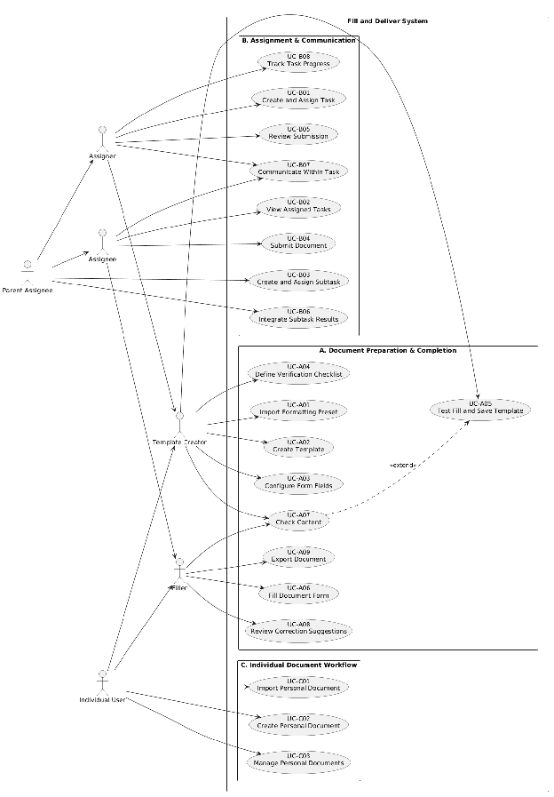

**Document: Fill and Deliver**

# **Use-Case Specification**

# **Version 1.1**

# **Revision History**

| Date | Version | Description | Author |
| ----- | ----- | ----- | ----- |
| **27/10/2026** | 1.0 | Full use-case model and 17 specifications aligned with Vision v2 and Communication Concept v2. | Bùi Nguyễn Đức Trọng, Huỳnh Nguyễn Khánh Duy |
| **29/10/2026** | 1.1 | Rewrite Group A as UC-A01 to UC-A09 aligned with Vision v2.1 (preset import, template creation, form fields with blank-pattern detection, checklist, test fill, filling, content check, correction suggestions, export); move UC-06 to Group C; merge UC-17 into UC-C02; UC-B01 selects templates from the library; UC-B05 uses the export rules of UC-A09. | Nguyễn Hữu Phước |
|  |  |  |  |
|  |   |  |  |

# **Table of Contents**

1\.	Use-case Model	[4](#use-case-model)

2\.	Use-case Specifications	[4](#use-case-specifications)

2.1–2.3	Groups A–C — 20 Detailed Use Cases

1. # **Use-case Model** {#use-case-model}

Diagram

2. # **Use-case Specifications** {#use-case-specifications}

   ## **2.1. Group A — Document Preparation & Completion**

UC-A01 to UC-A09 covers preparing templates (importing formatting presets, creating templates, configuring form fields and verification checklists, and test filling) and completing documents (filling forms, checking content, reviewing correction suggestions, and exporting). Template Creator and Filler are contextual roles: in a task the Assigner acts as Template Creator and the Assignee as Filler, while an Individual User plays both roles for personal documents.

| Use case Name | UC-A01 — Import Formatting Preset |
| :---- | :---- |
| Brief description | Create a new formatting preset from a sample DOCX file, or get preset suggestions from a regulation, and review every value before saving. |
| Actors | Template Creator |
| Basic Flow | 1\. Template Creator chooses Import Preset and uploads a sample DOCX file. 2\. System reads page layout, fonts, sizes and spacing directly from the file. 3\. System labels which paragraph is which document component (for example title, signature block). 4\. System shows the review screen: the source of every value, flags for uncertain values and the list of rules it cannot support yet. 5\. Template Creator corrects values, optionally chooses an existing preset to extend, and enters a preset name. 6\. System saves the preset to the preset library. |
| Alternative Flows | A1 (step 1): Template Creator uploads a regulation document instead. System suggests preset values, each with a quotation from the regulation as evidence, and continues at step 4\. If the suggestions are not reliable enough, system only highlights the relevant clauses and the creator fills in the values manually. A2 (step 1): Unsupported or corrupt file; system rejects it with an error. A3 (step 5): Name already used or a required value is missing; system requests correction. |
| Pre-conditions | Template Creator is authenticated. |
| Post-conditions | A reviewed preset is stored in the preset library. Existing templates, Drafts and Submission snapshots are unchanged. |

| Use case Name | UC-A02 — Create Template |
| :---- | :---- |
| Brief description | Prepare a new template by generating a formatted skeleton from a preset or by uploading an existing DOCX template. |
| Actors | Template Creator |
| Basic Flow | 1\. Template Creator chooses Create Template. 2\. System offers two sources: generate from a preset, or upload a DOCX template. 3\. Template Creator chooses Generate from Preset, then selects a preset (built-in or from the library) and a document type. 4\. System generates a formatted skeleton with standard text (such as the national title and motto) filled in and labeled blanks for the content. 5\. Template Creator replaces organization constants once (such as organization name and signer title). 6\. System opens field configuration (UC-A03). |
| Alternative Flows | A1 (step 3): Template Creator uploads a DOCX template instead; system keeps its original formatting and continues at step 6\. A2 (step 3): No preset fits the document type; system offers DOCX upload or Import Formatting Preset (UC-A01). A3 (A1): Uploaded file is unsupported or corrupt; system rejects it with an error. |
| Pre-conditions | Template Creator is authenticated. |
| Post-conditions | A template draft exists, either generated from a preset (with a reference to that preset) or uploaded from DOCX (keeping its original formatting); it is not yet available for use until it is saved in UC-A05. |

| Use case Name | UC-A03 — Configure Form Fields |
| :---- | :---- |
| Brief description | Turn a template into a fill-in form: detect fields, extract instructions, lock fixed text and set field types. |
| Actors | Template Creator |
| Basic Flow | 1\. System detects fillable fields from markers (such as {{field name}}), from comments, and from blank patterns: dotted lines, underscores, and empty table cells next to a label. 2\. System extracts the instructions attached to each field and marks all other text as locked. For blank patterns, system uses the text before the blank as the field label and infers the field type from the label (for example "Ngày sinh" → date, "Số tiền" → amount of money). 3\. System shows the proposed fields next to the document. 4\. Template Creator adds, removes or renames fields, and maps a field to one or more positions in the document. 5\. Template Creator sets each field's type (short text, long text, date, number, amount of money, choice), required flag and instructions. 6\. System saves the field configuration with the template draft. |
| Alternative Flows | A1 (step 1): No fields detected; system shows an empty proposal and the creator marks fields manually. A2 (step 4): Two fields overlap the same text; system highlights the conflict and requests correction. A3 (step 4): Template Creator unlocks or locks a text segment manually. A4 (step 1): A blank pattern is ambiguous (for example "ngày ... tháng ... năm ..."); system proposes it as separate fields and the creator merges them manually. Language-model suggestions for such cases are planned for a later phase. |
| Pre-conditions | A template draft exists (from UC-A02). |
| Post-conditions | The template has valid field definitions; locked text cannot be edited by fillers. |

| Use case Name | UC-A04 — Define Verification Checklist |
| :---- | :---- |
| Brief description | Turn each field's requirements into automatic rules and semantic criteria used by the content check. |
| Actors | Template Creator |
| Basic Flow | 1\. Template Creator opens the checklist of a template. 2\. System splits each field's instructions into individual requirements and proposes a classification: automatic rule (such as length limits or number ranges), or semantic criterion, for each of the requirements. The required flag set in UC-A03 always applies and is not part of the checklist. 3\. Template Creator confirms each classification,  edits, adds or removes requirements. 4\. System validates the rules. 5\. Template Creator approves the checklist; system saves it with the template draft. |
| Alternative Flows | A1 (step 3): A requirement cannot be expressed as a rule; it is kept as a semantic criterion. A2 (step 4): Conflicting rules (for example minimum length above maximum); system requests correction. |
| Pre-conditions | The template has configured fields (UC-A03). |
| Post-conditions | An approved checklist is linked to the template draft. |

| Use case Name | UC-A05 — Test Fill and Save Template |
| :---- | :---- |
| Brief description | Try the form exactly as a filler would, without saving data, then store the template in the template library. |
| Actors | Template Creator |
| Basic Flow | 1\. Template Creator chooses Test Fill on draft template. 2\. System opens the form in test mode with the same layout as for fillers. 3\. Template Creator enters sample content and runs a content check (as in UC-A07). 4\. Template Creator chooses Save Template. 5.. System validates the template (fields and checklist), discards the test content and stores the template in the template library. |
| Alternative Flows | A1. (step 1): Template Creator skips the test fill; system warns and continues at step 5\. A2. (step 3): Content check service is unavailable; system shows automatic rule results only. A3. (step 4): Template Creator returns to UC-A03 or UC-A04 to reconfigure the template if it is performing incorrectly. |
| Pre-conditions | The template has configured fields. A verification checklist (UC-A04) is optional; without one, content checks cover required fields and field types only. |
| Post-conditions | The template is in the library and can be assigned through a task (UC-B01) or reused for personal documents (UC-C02). No test content is stored. |

| Use case Name | UC-A06 — Fill Document Form |
| :---- | :---- |
| Brief description | Enter content through a guided form with a live preview and automatic draft saving. |
| Actors | Filler |
| Basic Flow | 1\. Filler opens a Draft from an assigned task (UC-B02) or from a personal document (UC-C02, UC-C03). 2\. System shows the form and a collapsible live preview side by side; each field uses an input suited to its type and shows its instructions. 3\. Filler enters or edits content, using minimal rich text (bold, italic, lists) in long fields. 4\. System autosaves the Draft, refreshes the preview and updates the progress indicator. 5\. Filler leaves and later returns to continue. |
| Alternative Flows | A1 (step 3): Filler tries to edit locked text or a field outside their access; system blocks the change. A2 (step 3): Value does not match the field type (for example an invalid date); system shows an inline message. A3 (step 4): Autosave fails; system warns, keeps the edits locally and retries. |
| Pre-conditions | Filler has edit access to the Draft. |
| Post-conditions | The Draft contains the saved content. Previous Submission snapshots are unchanged. |

| Use case Name | UC-A07 — Check Content |
| :---- | :---- |
| Brief description | Check the Draft against the checklist and receive short, evidence-based feedback. |
| Actors | Filler, Template Creator (during a test fill in UC-A05) |
| Basic Flow | 1\. User (Filler or Template Creator in testing mode) requests a content check. 2\. System checks the automatic rules. 3\. System checks each semantic criterion with a language model. A finding about wrong content must quote the part of the content it refers to; a finding about missing content must cite the criterion and the field that was checked. 4\. System shows short feedback per field, with links to the fields that need attention; findings that do not meet these evidence rules are marked uncertain. 5\. User decides whether and how to revise the content. |
| Alternative Flows | A1 (step 3): Language model service is unavailable; system shows automatic rule results and states that semantic feedback is missing. A2 (step 2): The template or document has no approved checklist; system checks required fields and field types only and informs the filler. A3 (step 4): No issues found; system shows a successful check. |
| Pre-conditions | A Draft exists, or the Template Creator is test filling a template (UC-A05). |
| Post-conditions | Feedback is shown; the content is never changed by the check. |

| Use case Name | UC-A08 — Review Correction Suggestions |
| :---- | :---- |
| Brief description | Accept or reject small fixes for minor errors, shown as tracked changes. |
| Actors | Filler |
| Basic Flow | 1\. After a content check, Filler requests correction suggestions. 2\. System proposes only small fixes (spelling, typos, punctuation, writing conventions, terminology). Suggestions that change a number, date or name are allowed but highlighted separately so the filler can verify them; suggestions never rephrase a sentence. 3\. System shows the suggestions as tracked changes. 4\. Filler accepts or rejects each suggestion; accepted fixes are applied to the Draft and autosaved. |
| Alternative Flows | A1 (step 2): No errors found; system informs the filler. A2 (step 4): Filler rejects all suggestions; the Draft is unchanged. |
| Pre-conditions | A content check has been run on the Draft. |
| Post-conditions | Only suggestions accepted by the filler are applied; all other text is unchanged character by character. |

| Use case Name | UC-A09 — Export Document |
| :---- | :---- |
| Brief description | Export the completed document to DOCX or PDF, formatted by the template's preset, or keeping the original formatting if the template was uploaded from DOCX. |
| Actors | Filler, Assigner (exporting a Submission snapshot) |
| Basic Flow | 1\. Filler chooses Export and selects DOCX or PDF. 2\. System checks required fields and automatic rules. 3\. System renders the document with the template's preset, or fills the uploaded DOCX keeping its original formatting; the result is identical to the preview. 4\. System offers the file for download. |
| Alternative Flows | A1 (step 2): Required fields are missing or a rule is broken; the final version is blocked and the system offers a draft export marked as draft. A2 (step 2): Language model findings exist; system shows them as warnings without blocking. A3 (step 3): Rendering fails; system shows an error and offers retry. A4 (step 1): Assigner exports a specific Submission snapshot while reviewing it (UC-B05); the snapshot is rendered the same way and is not changed. |
| Pre-conditions | Filler has access to the Draft, or Assigner has access to the Submission snapshot. |
| Post-conditions | A file is produced; the Draft and Submission snapshots are unchanged. |

## **2.2. Group B — Assignment & Communication**

UC-B01 to UC-B08 describe task assignment, access to assigned work, field-scoped subtask delegation, immutable submission snapshots, independent review, manual integration of subtask results, task discussions, and progress tracking. Assigner and Assignee are contextual roles.

| Use case Name | UC-B01 — Create and Assign Task |
| :---- | :---- |
| Brief description | Create a form-based task and assign it within a workspace. |
| Actors | Assigner |
| Basic Flow | 1\. Assigner opens workspace and chooses Create Task. 2\. System displays templates from the template library (saved through UC-A05) and assignment settings. 3\. Assigner picks template(s), recipient(s), instructions and due date. 4\. System validates permissions and inputs. 5\. Assigner confirms; system creates task and independent recipient assignments. 6\. System notifies recipients. |
| Alternative Flows | A1 (step 3): The user selects an ineligible recipient or template or doesn’t select at all; the system displays a validation message and requests to choose the eligible ones only. A2 (step 4): Invalid deadline; request correction. |
| Pre-conditions | Assigner has permission to assign tasks in workspace; a template exists in the template library. |
| Post-conditions | Task and authorized assignments exist; recipients get the assignment and the attached templates, have the permission to view and edit their own work derived from these templates. . |

| Use case Name | UC-B02 — View Assigned Tasks |
| :---- | :---- |
| Brief description | Browse tasks assigned to the current user and access an authorized assignment. |
| Actors | Assignee |
| Basic Flow | 1\. Assignee opens workspace task list. 2\. System shows only authorized assignments and statuses. 3\. Assignee filters or selects a task. 4\. System displays task requirements, deadline and accessible Draft. |
| Alternative Flows | A1 (step 2): No assigned tasks; show empty state. A2 (step 4): Access revoked; deny details and refresh list. |
| Pre-conditions | User is authenticated and has workspace access. |
| Post-conditions | No data mutation; only permitted assignment information is disclosed. |

| Use case Name | UC-B03 — Create and Assign Subtask |
| :---- | :---- |
| Brief description | Delegate any nonempty subset of Parent Form fields, possibly overlapping existing subtasks, to one or multiple people. |
| Actors | Parent Assignee acting as Subtask Assigner |
| Basic Flow | 1\. Parent Assignee opens Parent Task and selects Create Subtask. 2\. System lists delegable fields from the Parent Form. 3\. User chooses nonempty subset, which may contain all fields. 4\. User enters title, assignees, instructions and deadline. 5\. System warns on overlapping fields and late deadline without blocking otherwise valid overlap. 6\. User confirms; system creates Subtask and independent assignments/Drafts for recipients. 7\. System displays created Subtask; Parent Draft remains untouched. |
| Alternative Flows | A1 (step 3): No field selected; block and request correction. A2 (step 5): Field already delegated; show overlap warning, allow confirm. A3 (step 6): Creation failure; no false success is shown. |
| Pre-conditions | User owns accessible Parent assignment and can assign within internal workspace. |
| Post-conditions | Subtask with delegated field IDs and separate per-recipient Drafts exists; Parent Task/Draft unchanged. |

| Use case Name | UC-B04 — Submit Document |
| :---- | :---- |
| Brief description | Capture immutable Submission snapshot from the current Draft without locking it and send it to the Assigner |
| Actors | Assignee |
| Basic Flow | 1\. Assignee opens own Draft and selects Submit. 2\. System displays submission scope and confirmation. 3\. Assignee confirms. 4\. System copies current authorized field values, template version, assignee and timestamp into new immutable Submission. 5\. System lists new Submission for review; Draft stays editable. |
| Alternative Flows | A1 (step 2): Required fields are missing or an automatic rule is broken; system lists the problems and blocks submission, using the same rules as the final export in UC-A09. Language model findings are shown as warnings only. A2 (step 4): Save fails; no Submission success is reported. A3 (step 1): No valid assignment or permission; block. |
| Pre-conditions | Assignee may submit the specified assignment; Draft exists. |
| Post-conditions | A new independent immutable Submission is stored. Draft may continue changing and earlier snapshots are unaffected. |

| Use case Name | UC-B05 — Review Submission |
| :---- | :---- |
| Brief description | Review one specific immutable Submission and record a decision. |
| Actors | Assigner |
| Basic Flow | 1\. Assigner opens submission list for an authorized assignment. 2\. System displays exact selected snapshot and its submission ID/version. 3\. Assigner checks content and adds feedback. 4\. Assigner selects Approve or Request Revision. 5\. System stores review associated with that specific snapshot and notifies assignee. |
| Alternative Flows | A1 (step 4): Request Revision; feedback is recorded. |
| Pre-conditions | Reviewer has access to submitted immutable snapshot. |
| Post-conditions | Decision is linked to submission\_id; no review reads live Draft and no snapshot is mutated. |

| Use case Name | UC-B06— Integrate Subtask Results |
| :---- | :---- |
| Brief description | Manually select, compare and incorporate delegated results into the editable Parent Draft. |
| Actors | Parent Assignee |
| Basic Flow | 1\. Parent Assignee opens Parent Task and views reviewed Subtask Submissions. 2\. System displays field-scoped contributions, including overlapping alternatives. 3\. User compares, chooses, combines or rewrites contributions. 4\. For Apply-to-field, system warns before overwrite and checks Parent Draft version. 5\. System updates chosen Parent Draft fields and records provenance for structured Apply. 6\. User may continue editing before submitting Parent separately. |
| Alternative Flows | A1 (step 2): No approved results; display empty state and allow manual Parent editing. A2 (step 4): Parent Draft changed since opened; require refresh/confirmation. A3 (step 3): Overlapping field submissions disagree; user resolves manually, no automatic merge. |
| Pre-conditions | Parent assignment is accessible; relevant Subtask results are visible. |
| Post-conditions | Parent Draft updated only by Parent Assignee; underlying Child snapshots remain immutable; Parent not auto-submitted. |

| Use case Name | UC-B07 — Communicate Within Task |
| :---- | :---- |
| Brief description | Exchange clarification and feedback within authorized task context. |
| Actors | Assigner / Assignee |
| Basic Flow | 1\. User opens an accessible task discussion. 2\. System displays messages visible under workspace/task permissions. 3\. User writes and sends a task-specific message. 4\. System stores message with author, timestamp and task association. 5\. Authorized participants receive the update. |
| Alternative Flows | A1 (step 3): Empty or invalid message; reject. A2 (step 2): User lacks permission; hide thread. A3 (step 4): Send fails; show retry. |
| Pre-conditions | User is authorized participant in task context. |
| Post-conditions | Message is stored in task history; it does not mutate Draft or Submission. |

| Use case Name | UC-B08 — Track Task Progress |
| :---- | :---- |
| Brief description | Observe task, assignment and Subtask progress without conflating child and parent status. |
| Actors | Assigner |
| Basic Flow | 1\. Assigner opens workspace task dashboard. 2\. System lists assigned tasks with due dates and statuses. 3\. Assigner selects a task to view recipient assignment progress. 4\. System shows Subtask aggregates, e.g. approved 1/2 assignments. 5\. Assigner filters overdue or pending items. |
| Alternative Flows | A1 (step 2): No tasks; show empty state. A2 (step 4): Child approved but Parent not submitted; show independent statuses. A3 (step 3): Unauthorized task; deny detail. |
| Pre-conditions | Assigner has workspace/task read permission. |
| Post-conditions | Accurate read-only progress is presented; no implicit state transition. |

## **2.3. Group C — Individual Document Workflow**

UC-C01, UC-C02 and UC-C03 cover importing a personal DOCX as a one-off document, creating personal documents from templates the user owns, and organizing them. These workflows work independently of workspace assignments or collaborative task reviews.

| Use case Name | UC-C01 — Import Personal Document |
| :---- | :---- |
| Brief description | Upload a personal DOCX, generate a form from it and complete it as a one-off personal document. |
| Actors | Individual User |
| Basic Flow | 1\. User selects Import Personal DOCX. 2\. System validates and parses the uploaded file. 3\. System proposes fillable fields in the same way as UC-A03 (markers, comments and blank patterns). 4\. User corrects the detected fields. 5\. System creates a personal document and Draft and opens the form (UC-A06). |
| Alternative Flows | A1 (step 2): Invalid or corrupt DOCX; reject. A2 (step 3): No fields recognized; allow manual field setup. |
| Pre-conditions | Authenticated user; eligible DOCX supplied. |
| Post-conditions | A private personal document and Draft exist without any task assignment. The document has no approved checklist, so content checks cover required fields and field types only (UC-A07), and its fixed text is not guaranteed to be locked. |

| Use case Name | UC-C02 — Create Personal Document |
| :---- | :---- |
| Brief description | Create a privately owned document from a template, without any collaborative task. |
| Actors | Individual User |
| Basic Flow | 1\. User chooses New Personal Document. 2\. System lists the personal templates the user owns (created through UC-A02 and saved through UC-A05). 3\. User selects a template, previews its fields and formatting, and enters a document name. 4\. System creates an independent personal document instance and Draft; the source template is unchanged. 5\. System opens the form for filling (UC-A06). |
| Alternative Flows | A1 (step 2): No templates; offer Import Personal Document (UC-C01) or Create Template (UC-A02). A2 (step 3): Template missing or incompatible, or invalid name; explain and request correction. A3 (step 4): Creation fails; no document is created and the template is preserved. |
| Pre-conditions | Authenticated user with personal document access. |
| Post-conditions | A private personal document and editable Draft exist with no assignment or submission relationship; the source template and other documents are unchanged. |

| Use case Name | UC-C03 — Manage Personal Documents |
| :---- | :---- |
| Brief description | Find, resume, rename, and remove personal document instances. |
| Actors | Individual User |
| Basic Flow | 1\. User opens My Documents. 2\. System lists documents owned by user. 3\. User searches or selects a document. 4\. System opens editor or offers rename/delete actions. 5\. User confirms selected management action; system persists change. |
| Alternative Flows | A1 (step 2): No documents; show empty state. A2 (step 4): Delete selected; request confirmation before removal. A3 (step 5): Access conflict or failure; preserve unchanged document and report error. |
| Pre-conditions | Authenticated user owns at least the selected document for mutation. |
| Post-conditions | Only user's personal document metadata/content is accessed or changed. |
