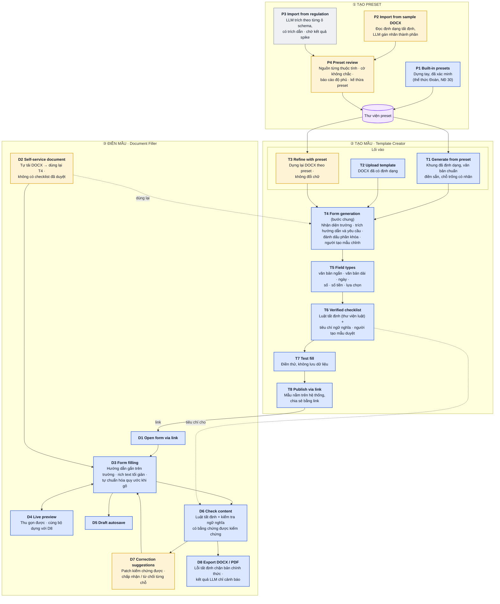

# Feature Workflow – Tạo mẫu và điền mẫu

Automatic Document Filing with Forms · Phạm vi: tạo preset, tạo mẫu, publish qua link, điền và xuất văn bản. Giao việc, nộp bài và duyệt nằm ngoài phạm vi MVP.

## 1. Tổng quan workflow

Hệ thống tách **nội dung** khỏi **hình thức**. Hình thức được mô tả bằng **preset** (quy chuẩn định dạng). Người tạo mẫu dựng **mẫu** gồm phần cố định và các trường cần điền, rồi publish thành **một link**. Người điền mở link, chỉ nhập nội dung; hệ thống tự định dạng, kiểm tra và xuất văn bản đúng chuẩn.

Workflow có ba giai đoạn nối tiếp: **(1) Tạo preset → (2) Tạo mẫu → (3) Điền mẫu**. Dù mẫu được tạo bằng cách nào, mọi văn bản đều được dựng bởi cùng một bộ dựng định dạng, nên văn bản xuất ra luôn đúng preset.

### ① Tạo preset

1. Dùng preset có sẵn (**P1**), hoặc nạp preset mới từ file DOCX mẫu (**P2**) hay từ văn bản quy định (**P3**).
2. Preset nạp mới phải qua **Preset review (P4)**: mỗi thuộc tính có nguồn, giá trị không chắc được đánh dấu, quy định chưa hỗ trợ được liệt kê.
3. Preset đã duyệt được lưu vào **thư viện preset**.

### ② Tạo mẫu (Template Creator)

1. Chọn một trong ba lối vào: sinh mẫu từ preset (**T1**), tải mẫu có sẵn (**T2**), hoặc refine một văn bản theo preset (**T3**).
2. Cả ba lối đều qua **Form generation (T4)**: nhận diện trường, trích hướng dẫn và yêu cầu, đánh dấu phần khóa; người tạo mẫu chỉnh lại.
3. Khai báo **kiểu trường (T5)**, rồi duyệt **Verified checklist (T6)**: yêu cầu được chia thành luật tất định và tiêu chí ngữ nghĩa.
4. **Điền thử (T7)** để thấy đúng trải nghiệm của người điền, sau đó **publish thành link (T8)**.

### ③ Điền mẫu (Document Filler)

1. Mở form qua **link (D1)**, hoặc tự tải văn bản của mình lên (**D2**, dùng lại Form generation).
2. **Điền form (D3)**: hướng dẫn luôn hiển thị trên từng trường; quy ước viết (ngày tháng, số tiền) được tự chuẩn hóa ngay khi gõ. **Xem trước trực tiếp (D4)** và **tự lưu bản nháp (D5)** chạy song song.
3. Bấm **Check content (D6)**: luật tất định và tiêu chí ngữ nghĩa trong checklist được kiểm tra; mỗi kết luận của LLM có bằng chứng trích từ nội dung người dùng.
4. Nhận **gợi ý sửa (D7)** dạng patch kiểm chứng được; chấp nhận hoặc từ chối từng chỗ.
5. **Xuất DOCX/PDF (D8)** bằng cùng bộ dựng với bản xem trước.

## 2. Diagram

Chú thích màu: xanh dương là **MVP**, vàng là **Later** (sau MVP), xám là **Stretch** (nếu còn thời gian), tím là dữ liệu. Nét liền là luồng chính, nét đứt là dùng lại hoặc tham chiếu.

## 3. Danh mục tính năng

### ① Tạo preset

| Mã | Tính năng | Mô tả | Phụ thuộc | Giai đoạn |
|---|---|---|---|---|
| P1 | Built-in presets | Thư viện preset dựng tay và đã xác minh: thể thức văn bản Đoàn, Nghị định 30. | – | MVP |
| P2 | Import preset from sample DOCX | Đọc font, cỡ chữ, lề, khoảng cách trực tiếp từ file DOCX (tất định); LLM chỉ gán nhãn đoạn nào là thành phần nào. Có thể kế thừa một preset gốc. | P4 | Later |
| P3 | Import preset from regulation | LLM trích xuất theo từng ô của schema từ văn bản quy định, mỗi giá trị kèm trích dẫn, chạy nhiều lần để phát hiện giá trị không thống nhất. Chỉ làm nếu spike ở sprint 2 đạt ngưỡng; nếu không, làm chế độ hỗ trợ (chỉ tô sáng điều khoản liên quan). | P4 | Stretch |
| P4 | Preset review | Màn hình duyệt preset vừa nạp: nguồn của từng thuộc tính, cờ "không chắc", danh sách quy định chưa hỗ trợ, văn bản thử. Bước bắt buộc của P2 và P3. | – | Later |

### ② Tạo mẫu – Template Creator

| Mã | Tính năng | Mô tả | Phụ thuộc | Giai đoạn |
|---|---|---|---|---|
| T1 | Generate template from preset | Chọn preset và loại văn bản; hệ thống sinh khung đã định dạng và đặt đúng vị trí. Văn bản chuẩn (Quốc hiệu, Tiêu ngữ) được điền sẵn; hằng số đơn vị (tên cơ quan, chức vụ ký) người tạo mẫu thay một lần; nội dung từng văn bản trở thành trường cho người điền. | Thư viện preset | MVP |
| T2 | Upload existing template | Tải lên DOCX đã có định dạng; không cần preset. | T4 | MVP |
| T3 | Refine document with preset | Tải lên một văn bản bất kỳ, chọn preset; hệ thống gán nhãn thành phần (quy tắc, LLM khi cần), người tạo mẫu xác nhận, rồi dựng lại theo preset. Nội dung chữ không bị thay đổi. | Thư viện preset | Later |
| T4 | Form generation | Bước chung của T1–T3 và D2. Nhận diện trường cần điền (theo quy ước `{{...}}` và comment; LLM dự phòng ở giai đoạn sau), trích hướng dẫn và yêu cầu, đánh dấu phần khóa. Người tạo mẫu chỉnh lại. | – | MVP |
| T5 | Field types | Khai báo kiểu cho từng trường: văn bản ngắn, văn bản dài, ngày, số, số tiền, lựa chọn. Cần cho việc chuẩn hóa quy ước. | T4 | MVP |
| T6 | Verified checklist | Hướng dẫn và yêu cầu được tách thành tiêu chí nguyên tử, ánh xạ vào thư viện luật tất định định nghĩa sẵn; phần còn lại là tiêu chí ngữ nghĩa. Người tạo mẫu duyệt. MVP: luật thủ công đơn giản (bắt buộc, độ dài) cộng hướng dẫn tự do; bản đầy đủ ở giai đoạn sau. | T4, T5 | MVP / Later |
| T7 | Test fill | Người tạo mẫu điền thử và chạy Check content để thấy đúng trải nghiệm của người điền. Dùng lại D3, D4, D6 ở chế độ thử, không lưu dữ liệu. | D3, D4, D6 | MVP |
| T8 | Publish via link | Đưa mẫu lên hệ thống và tạo link chia sẻ. Không xuất mẫu ra file, để giữ phần khóa, hướng dẫn và kiểm tra. Quản lý phiên bản mẫu ở giai đoạn sau. | T4–T6 | MVP |

### ③ Điền mẫu – Document Filler

| Mã | Tính năng | Mô tả | Phụ thuộc | Giai đoạn |
|---|---|---|---|---|
| D1 | Open form via link | Người điền mở form từ link do người tạo mẫu chia sẻ. | T8 | MVP |
| D2 | Self-service document | Người điền tự tải văn bản của mình lên; hệ thống dùng lại T4 để tạo form. Không có checklist đã duyệt và không bảo đảm phần khóa. | T4 | Later |
| D3 | Form filling | Ô nhập theo kiểu trường, rich text tối giản (đậm, nghiêng, danh sách), hướng dẫn luôn hiển thị, tiến độ hoàn thành. Quy ước viết (ngày tháng, số tiền, số ký hiệu) được tự chuẩn hóa ngay khi gõ. | T5 | MVP |
| D4 | Live preview | Bản xem trước văn bản hoàn chỉnh, thu gọn được, dựng bằng cùng bộ dựng với file xuất. | – | MVP |
| D5 | Draft autosave | Tự lưu bản nháp để tiếp tục soạn qua nhiều phiên. | – | MVP |
| D6 | Check content | Kiểm tra theo checklist: luật tất định bằng code; tiêu chí ngữ nghĩa bằng LLM, từng tiêu chí một, mỗi kết luận phải có đoạn trích từ nội dung người dùng và được code kiểm chứng; không đủ căn cứ thì trả về "không chắc". Báo thêm các chỗ chưa đúng quy ước trong đoạn văn tự do. | T6 | MVP / Later |
| D7 | Correction suggestions | LLM đề xuất sửa chính tả, quy ước, thuật ngữ và câu chữ nhỏ dưới dạng patch. Code kiểm tra phạm vi, độ lớn thay đổi và việc giữ nguyên số liệu, ngày, tên riêng. Hiển thị kiểu track changes; người dùng chấp nhận từng chỗ. Không được thêm ý mới. | D6 | Later |
| D8 | Export DOCX / PDF | Xuất văn bản bằng cùng bộ dựng với bản xem trước. Lỗi tất định (thiếu trường bắt buộc, sai luật) chặn bản chính thức nhưng vẫn cho xuất bản nháp; kết quả của LLM chỉ cảnh báo. | D6 | MVP |
